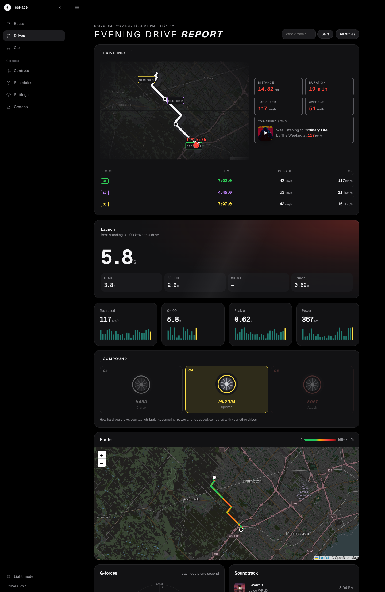
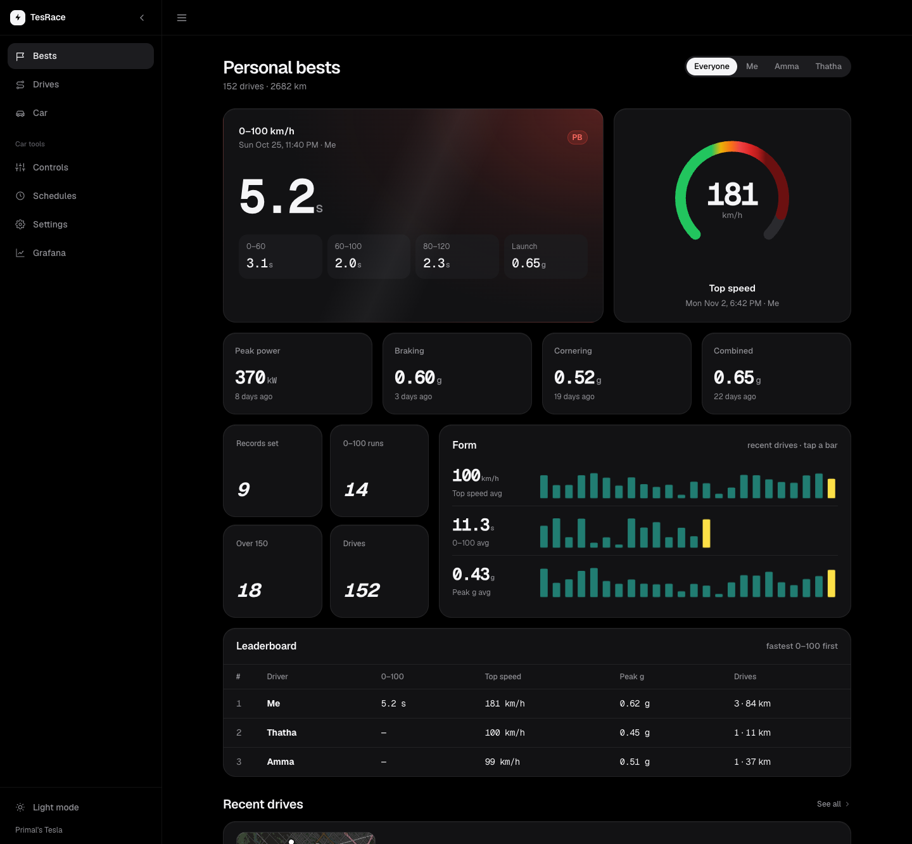
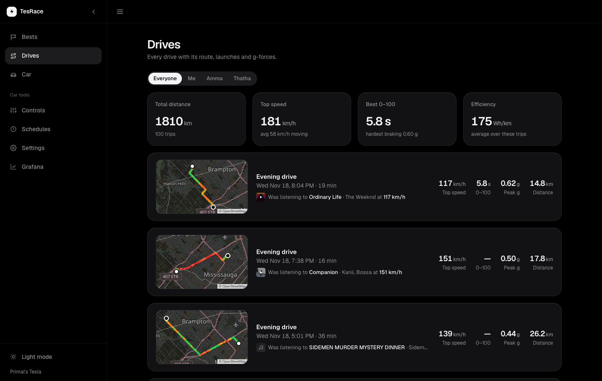

# TesRace

A self-hosted dashboard for my Tesla that turns every drive into a race report.

## Why

Tesla's Fleet Telemetry lets the car stream its data to your own server every second while it's awake: speed, g-forces, battery current, GPS. I wanted to see what I could do with that, and the obvious answer was to treat every drive like a qualifying lap. 0–100 times, top speeds, how hard I braked, what song was on when I hit my top speed. It started as a weekend thing and kept growing.

It runs on my Mac in Docker and is only reachable over Tailscale.

## What it does

**Personal bests.** Fastest 0–100, plus 0–60, 60–100 and 80–120 picked out of normal driving, so you don't need to do a dedicated run. Top speed, peak power, braking, cornering and combined g. A form chart of recent drives, and a leaderboard if more than one person drives the car.

**Drive reports.** Every drive gets its own page:
- the route over a faint street map, split into three sectors with times
- the song that was playing at top speed (with album art; tap it for a 30 s preview)
- launch splits, and how this drive stacks up against the rest
- a tyre compound (Hard, Medium or Soft) for how hard you drove
- a full route map coloured by speed, a g-force plot, the soundtrack, and speed/power/battery charts

**Sections.** Hit "Record" (or an iPhone Shortcut) partway through a drive and "Stop" when you're done. You get stats for just that bit, like a twisty road, without the drive there and back.

**Drives list.** Every drive with a map preview, key numbers and what you were listening to at top speed.

**Drivers.** A phone check-in tags who's driving, so each person gets their own bests.

**Now playing.** What's on in the car, with cover art. Works for Spotify, radio and Bluetooth since it only needs the title and artist.

**Live drive.** A live card while the car is moving.

**The car side.** Battery and climate, remote controls (climate, locks, charging, sentry), a preheat planner that uses the weather, scheduled warm-ups, and a Claude-powered assistant so I can text "warm it up, I'll be there in 15". Discord ping when the car starts a drive. Grafana for raw graphs.

## How it's built

- Go, Postgres, html/template and htmx. No JS framework.
- Tesla Fleet API for car data and signed commands, Fleet Telemetry for the live stream.
- Leaflet + OpenStreetMap for maps, Open-Meteo for weather, the iTunes Search API for album art and previews.
- Everything runs in Docker Compose. The dashboard stays on the tailnet; only the telemetry port and the public key site are exposed.

Telemetry is billed per value the car sends, which works out to about 10–15 cents per hour of driving with the current fields.

## Running it

See [SETUP.md](SETUP.md). You'll need a Tesla developer app, a domain for the public key, and Docker.
